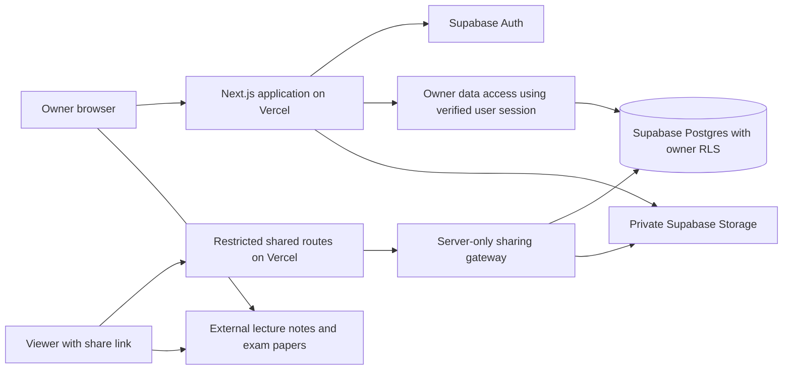

# Personal OS — Project Overview, Product Requirements, Technical Architecture, and Development Roadmap

**Version:** 1.0  
**Date:** 18 October 2026  
**Status:** Implementation planning baseline  
**Initial release:** Personal OS foundation + Education / Campus  
**Deployment:** Vercel + Supabase  
**Audience:** Product owner, designer, and developer

This document combines the product definition, requirements, technical design, and delivery plan for Personal OS. It incorporates the agreed simplified quiz behaviour, Markdown question pages, and restricted viewer sharing. It describes the application to be built; it does not indicate that the application has already been implemented.

## Contents

1. [Project overview](#1-project-overview)
2. [Product requirements](#2-product-requirements)
3. [Technical design and architecture](#3-technical-design-and-architecture)
4. [Development plan and roadmap](#4-development-plan-and-roadmap)
5. [Decisions, assumptions, and future expansion](#5-decisions-assumptions-and-future-expansion)

---

## 1. Project overview

### 1.1 Product vision

Personal OS is a private web application for organising the owner's personal life, business, and education in one place. Its first working area is **Education → Campus**, providing a practical home for university materials, study questions, academic results, and semester planning.

The owner should be able to answer four questions quickly:

1. What classes and academic deadlines are coming next?
2. Where are the lecture materials and questions I need?
3. What have I studied, and what needs attention?
4. What marks and academic results have I recorded?

Friends can access selected study materials through read-only share links. They do not receive access to the owner's academic administration or the wider OS.

### 1.2 Confirmed product decisions

| Topic | Agreed direction |
|---|---|
| Application | Online web application |
| Hosting | Vercel for the application; Supabase for backend services |
| Owner access | One owner account with full access to the OS |
| Viewer access | Read-only share links; viewers do not need accounts |
| First implementation | OS foundation and Campus; other areas follow later |
| Lecture notes | External links with thumbnails; original lecture documents are not uploaded to the app |
| Quizzes | Upload Markdown, extract questions/answers/explanations, and reveal answers per question |
| Question documents | Render uploaded tutorial, practical, and essay Markdown as readable pages |
| Document format | One Markdown project document |

Technical selections and detailed defaults below are proposed implementation decisions. They can be adjusted without changing these confirmed requirements.

### 1.3 First-release scope

**Included:**

- A responsive OS shell with Home, Personal, Business, Education, and Settings.
- Campus home, academic profile, semesters, modules, and lectures.
- External lecture-note links and thumbnails.
- Simple Markdown quizzes and Markdown question documents.
- Exam papers, exam practice materials, and exam dates.
- Private references and basic group-project records.
- Assessment marks, module summaries, semester GPA, and CGPA.
- Markdown timetable import, weekly timetable, and upcoming commitments.
- Read-only sharing of explicitly selected study materials.
- Search, archive, and owner data export.

**Reserved for later releases:**

- Personal projects, personal finance, and other Personal features.
- Business information, budgets, and financial management.
- Self Learning courses and learning paths.
- AI-generated questions, automatic marking of written answers, quiz history, timers, and question banks.
- Viewer accounts, real-time collaboration, and shared project editing.
- Automatic Drive synchronisation, university-system integrations, and external calendar synchronisation.
- Native mobile applications and offline editing.

### 1.4 Product principles

- **Study materials should be easy to reach.** Keep navigation predictable and content readable.
- **The owner creates content within a consistent structure.** Semester and module pages use predefined layouts; this is not a general page-builder product.
- **Academic results and practice are separate.** Revealing a quiz answer never updates official marks.
- **Private information stays private.** Sharing exposes only selected learning materials and minimal navigation labels.
- **Store each fact once.** A deadline recorded against an assessment appears in the dashboard and calendar through the same record.
- **Build the active area well.** Establish extension points for future OS areas without implementing their unused features now.

### 1.5 Release success criteria

The release succeeds when the owner can set up a real semester, use it during a normal study week, record academic results, and share materials with a friend without exposing private information. All acceptance checks in Section 4.4 must pass before the complete Campus release.

---

## 2. Product requirements

### 2.1 People, roles, and permissions

**Owner:** The user of the entire Personal OS. Can create, read, edit, organise, archive, export, and delete their records; manage academic information; and create or revoke sharing links.

**Viewer:** Anyone holding a valid sharing link. Can read only the selected materials covered by that link. Viewer is a product access role, not a second account type in the first release.

| Capability | Owner | Viewer with valid link |
|---|---|---|
| Open selected lecture-note links and see their thumbnails | Yes | Yes |
| Read selected tutorial, practical, and essay documents | Yes | Yes |
| Read selected exam papers and exam question documents | Yes | Yes |
| Use selected quizzes and reveal answers/explanations | Yes | Yes |
| See semester/module/lecture names needed to navigate shared items | Yes | Limited labels only |
| Upload, edit, reorder, archive, or delete content | Yes | No |
| View marks, GPA, CGPA, achievements, or academic profile | Yes | No |
| View timetable, deadlines, owner study status, or private dashboards | Yes | No |
| View private reference collections, projects, or project briefs | Yes | No |
| Access Personal, Business, Self Learning, or OS settings | Yes | No |
| Generate links or change permissions | Yes | No |

Selecting quiz options and revealing answers changes only temporary page state. It creates no viewer records or academic marks.

### 2.2 Information architecture

```text
Personal OS
├── Home
├── Personal                         [future]
├── Business                         [future]
├── Education
│   ├── Campus
│   │   ├── Overview
│   │   ├── Academic profile
│   │   ├── Achievements
│   │   └── Semesters
│   │       └── Semester
│   │           ├── Overview
│   │           ├── Modules
│   │           │   └── Module
│   │           │       ├── Overview
│   │           │       ├── Lectures
│   │           │       │   └── Lecture
│   │           │       │       ├── Notes: links + thumbnails
│   │           │       │       ├── Quizzes
│   │           │       │       └── Questions: tutorial / practical / essay
│   │           │       ├── Assessments & marks
│   │           │       ├── Exam preparation
│   │           │       ├── References
│   │           │       └── Projects
│   │           ├── Timetable & calendar
│   │           └── Results
│   └── Self Learning                [future]
└── Settings

Shared Study Materials               [separate viewer interface]
└── Selected module/lecture materials and exam practice
```

The owner can create multiple semesters, modules, lectures, and documents. Lists support ordering and meaningful empty states. A folder-like presentation does not mean records are arbitrary filesystem folders.

### 2.3 Functional requirements

All requirements labelled **FR** below are part of the complete first Campus release. The roadmap delivers them incrementally.

#### FR-01 — OS foundation and owner access

- Provide one authenticated owner workspace and persistent navigation.
- Provision the owner account explicitly; disable public self-registration.
- Support sign-in, sign-out, and password recovery.
- Default the workspace timezone to `Asia/Colombo`, with an editable setting.
- Show inactive OS areas as clearly labelled future areas without building their management screens.
- Keep the viewer interface separate from the owner navigation.

**Acceptance:** A signed-out visitor cannot retrieve owner pages or their underlying data. An authenticated account that is not the provisioned workspace owner has no workspace access.

#### FR-02 — Campus home and academic profile

- Show current semester, upcoming classes, upcoming assessment/project deadlines, and links to recently opened owner study materials.
- Show module cards with study progress, upcoming work, and clearly labelled marks summaries.
- Display calculated CGPA and its included-credit count when sufficient finalised results exist.
- Store university, programme, start year, and optional expected completion date.
- Support manually recorded achievements with title, semester, date, and optional evidence link.
- Display empty or incomplete states honestly; do not invent grades or achievement eligibility.

**Acceptance:** Campus home derives its classes, deadlines, and results from their original records, and updates after those records change.

#### FR-03 — Semesters

- Create/edit a semester with name, academic year, start/end dates, and status: planned, active, or completed.
- Select at most one active semester as the primary current semester.
- Provide semester overview, modules, timetable/calendar, and results views.
- Preserve completed semesters as accessible history.
- Support archive and restore as described in FR-14.

**Acceptance:** Semester results and materials remain separate between semesters. Creating a new semester does not copy marks or study status.

#### FR-04 — Modules

- Create/edit a module inside a semester with title, code, credits, and optional lecturer/contact details.
- Provide consistent module areas for lectures, marks, exam preparation, references, and projects.
- Allow unused areas to be hidden in owner preferences.
- Treat a repeated module in another semester as a separate module record.

**Acceptance:** Editing a repeated module does not alter its earlier-semester record.

#### FR-05 — Lectures and externally hosted notes

- Create/edit/reorder lectures with title, optional topic/date, and owner study status: not started, studying, or reviewed.
- Attach multiple note links, each with title, destination URL, and optional thumbnail.
- Allow a thumbnail image upload or an approved external image URL; provide a default thumbnail otherwise.
- Open original documents at their external location.
- Provide separate Quizzes and Questions areas for each lecture.
- Keep study status owner-only; opening a link does not automatically mark a lecture reviewed.

**Acceptance:** The app stores note metadata and optional thumbnail assets, but never uploads, proxies, or duplicates the original lecture documents.

#### FR-06 — Simple Markdown quizzes

- Upload a `.md` file using the published quiz template in Section 3.6.
- Extract the quiz title and ordered questions, including each answer and explanation.
- Support two initial question types: single-answer multiple choice and written/self-check questions. True/false can use two multiple-choice options.
- Show each question clearly with a **Show answer** control.
- Reveal that question's answer and explanation directly beneath it.
- Let readers select a multiple-choice option before revealing; allow reveal without selecting.
- Keep written questions as self-check practice; do not require a text submission.
- Provide an import preview and useful errors before saving.
- Allow the owner to edit source Markdown, replace the file, or delete the quiz.
- Use the same renderer for lecture quizzes and module exam-practice quizzes.

**Acceptance:** A valid import displays every question, answer, and explanation in the original order. Revealing one answer leaves other questions unchanged. Reloading resets temporary selections and reveals. There is no score persistence, timer, attempt history, or automatic marks update.

#### FR-07 — Markdown question documents

- Upload a `.md` question document and select its title and category: tutorial, practical, or essay for lecture documents; exam for module exam documents.
- Render its content as written, with headings, lists, tables, code blocks, links, and mathematical notation.
- Preserve the supplied question numbering and section order.
- Display any included answers as ordinary document content; no extraction or answer-reveal behaviour applies here.
- Allow owner source editing, replacement, and deletion.

**Acceptance:** A question file opens as a readable Markdown page. It does not need the quiz template and is never processed as a quiz.

#### FR-08 — Exam preparation

- Store external past-paper and solution links with title, year, and exam type.
- Attach exam-practice quizzes and rendered exam question documents at module level.
- Record official exam date/time and location as private calendar information.
- Keep official exam marks in assessment/results records.

**Acceptance:** A shared exam-practice page exposes only selected papers/documents/quizzes. It does not expose exam marks, private scheduling information, or other module data.

#### FR-09 — References and group projects

- Store private video, webpage, and book/reference links at module level.
- Create a project with title, status, optional due date, team-member names/roles, and the owner's responsibilities.
- Upload a Markdown project brief and render it directly.
- Add project links and simple milestones with due dates and completion status.
- Include project dates/milestones in the owner's upcoming-work view.
- Keep all reference collections, project details, and project briefs owner-only in this release.

**Acceptance:** Project Markdown renders without a project-extraction engine. Team members are descriptive information, not collaborating application users.

#### FR-10 — Assessments and marks

- Record assessment name/type, contribution weight, maximum marks, awarded marks, due date, and submission status.
- Support pending, awarded, and missing mark states. Pending/missing records do not silently become awarded zeroes.
- Show recorded contribution, graded-weight coverage, average on graded work, and remaining weight as separate values.
- Validate positive maximum marks, scores within range, and weights between 0 and 100.
- Allow incomplete weighting setups while drafting; warn when the total differs from 100% and block a calculated final result until resolved.
- Separate official graded assessments from Markdown practice quizzes.
- Support manual entry of a published official module result, with a clear source label.

**Example:** Coursework weighted 30% with 80/100 contributes 24 percentage points. A midterm weighted 20% with 70/100 contributes 14. With the 50% final exam pending, recorded contribution is 38 points, graded coverage is 50%, and average on graded work is 76%.

**Acceptance:** These three values remain distinct. A pending final exam never causes the application to label 38% as the completed module result.

#### FR-11 — GPA, CGPA, and academic history

- Configure a basic grading scheme: percentage thresholds, letter grades, and grade points.
- Record module credits and whether a finalised result is included in GPA/CGPA.
- Calculate semester GPA and CGPA from eligible finalised results using credit weighting.
- Show the number of credits included and which results were excluded.
- Preserve grading-scheme version and credits used by finalised results.
- Allow historical semesters/modules/results to be entered without entering their lectures.
- Let the owner explicitly choose inclusion for repeated or exceptional modules; record a reason for manual exclusions/overrides.
- Support optional recording of a university-published CGPA separately from the app-calculated value.

**Acceptance:** GPA stays unavailable when there are no eligible finalised credits. Practice activity never changes GPA. Special university rules are verified during setup, with exceptional cases handled explicitly rather than guessed.

#### FR-12 — Timetable and semester calendar

- Import a timetable from the Markdown table template in Section 3.7.
- Match entries against module codes in the selected semester.
- Preview sessions and flag invalid values, unknown codes, and time overlaps.
- Offer explicit **Add sessions** or **Replace timetable** actions.
- Detect exact duplicates and require deliberate confirmation for legitimate overlapping sessions.
- Show a weekly timetable and an agenda.
- Support manual edits, one-off cancellation/rescheduling, and private exam events.
- Combine timetable occurrences, assessment deadlines, project due dates, and milestones in a read-only calendar view.

**Acceptance:** Importing the same file twice does not silently duplicate sessions. Replacing a timetable is atomic and requires confirmation because it also replaces that timetable's exceptions.

#### FR-13 — Read-only sharing

- Create a share link from a module or lecture.
- Show a checklist of eligible study materials; share only explicitly selected items.
- Eligible items are lecture-note links, quiz documents, question documents, and exam-paper/solution links.
- Keep new uploads private until explicitly added to a share link.
- Allow a link label, optional expiry, changes to selected items, and immediate revocation for subsequent requests.
- Provide an owner preview of exactly what a viewer receives.
- Use a separate viewer layout showing only shared items and required navigation labels.
- Make expired, revoked, invalid, and out-of-scope requests return the same generic unavailable response.

**Acceptance:** Knowing a private record ID or another module's URL never expands access. Revoked links cannot load fresh content. No viewer request can create, edit, or delete records.

**Sharing model:** Anyone holding the link can read its selected materials and forward the link. Answers are intentionally revealable; this is study sharing, not a secure exam system. Revocation cannot remove information someone has already viewed or copied. External Drive links still depend on their own sharing settings.

#### FR-14 — Search, archive, and export

- Search owner-accessible semester/module/lecture names, document titles, and resource titles; add filters by semester and module.
- Keep viewer navigation/search limited to items selected for the current link.
- Archive semesters/modules/lectures without deleting historical records.
- Archiving revokes affected share links; restoring content does not reactivate revoked links.
- Require explicit confirmation for permanent deletion and explain affected descendants.
- Provide an owner export containing structured records, Markdown source, resource URLs, and uploaded thumbnail assets.
- Exclude passwords, authentication tokens, secret keys, raw sharing tokens, and active sharing grants from a portable export. Exporting a lecture note exports its link, not the externally hosted document.

**Acceptance:** Exported academic records and Markdown remain usable outside the application. Deleted or archived material cannot continue to appear through an active share link.

### 2.4 Primary user journeys

**Start a semester:** Sign in → create semester → mark current → add modules and credits → configure grading scheme → import timetable.

**Prepare a lecture:** Open module → create lecture → add note links/thumbnails → upload quiz → preview/save → upload question documents under their categories.

**Study:** Open a lecture → follow notes → read tutorial/practical/essay questions → use quiz reveals → manually update study status.

**Record progress:** Add assessments and weights → record awarded marks → inspect module summary → enter/finalise published results → review GPA/CGPA.

**Share with a friend:** Open Share → select materials → preview → create link → send link outside the app. Friend opens the restricted study interface without signing in. Owner can later edit the selection or revoke access.

### 2.5 Non-functional requirements

| Area | Requirement |
|---|---|
| Privacy | Enforce permissions on pages, server operations, database access, assets, and search results. Never send private fields to viewer browsers. |
| Readability | Comfortable document width, clear typography, usable code/table overflow, and clear answer/explanation styling. |
| Responsive design | Owner workflows work on laptop and phone; viewer reading and quizzes work comfortably at a 360px viewport. |
| Accessibility | Semantic headings, labelled inputs, visible keyboard focus, sufficient contrast, and keyboard-operable answer reveals. |
| Time handling | Store absolute timestamps consistently; interpret timetable wall-clock times in the workspace timezone. Show the timezone when useful. |
| Reliability | Validate imports before saving; use atomic replacement operations; retain existing content after a failed replacement. |
| Data integrity | Enforce relationships and mark constraints in the database as well as the UI. Reject stale edits instead of silently overwriting newer changes. |
| Performance | Paginate long lists, load document bodies only when needed, and avoid loading the whole OS for a shared page. Measure representative pages before release. |
| Maintainability | Typed application code, versioned database migrations, reusable content renderers, and focused automated checks. |
| Recovery | Document export and database/asset backup restoration. Verify a recovery path before relying on the app for live academic data. |

**Proposed initial limits:** UTF-8 Markdown files up to 1 MiB, quizzes up to 100 questions, and uploaded JPEG/PNG/WebP thumbnails up to 2 MiB. These are application defaults, not claims about hosting-provider limits. Revisit them after testing real university materials.

---

## 3. Technical design and architecture

### 3.1 Selected technology stack

Use one full-stack Next.js application and Supabase. This keeps deployment and maintenance manageable while supporting both private owner workflows and public-link study pages.

| Layer | Selection | Purpose and rationale |
|---|---|---|
| Web framework | Next.js App Router + React + TypeScript | Routing, server-rendered pages, interactive study components, and server-side operations in one codebase. [Next.js documentation](https://nextjs.org/docs/app) |
| Application hosting | Vercel | Host the Next.js application and its server operations. [Next.js on Vercel](https://vercel.com/docs/frameworks/full-stack/nextjs) |
| Database | Supabase Postgres | Relational academic records, Markdown source, quiz JSON, constraints, and permission policies. |
| Authentication | Supabase Auth + `@supabase/ssr` | Owner authentication with cookie-based server rendering. [Supabase SSR guide](https://supabase.com/docs/guides/auth/server-side) |
| Database client | `@supabase/supabase-js` + generated database types | Typed queries and database functions; a separate ORM is unnecessary initially. |
| Small uploaded assets | Supabase Storage, private bucket | Thumbnail images only in the initial release. [Storage access control](https://supabase.com/docs/guides/storage/security/access-control) |
| UI styling | Tailwind CSS + selected shadcn/ui components | Consistent layouts, forms, dialogs, and navigation. [Tailwind installation](https://tailwindcss.com/docs/installation/framework-guides/nextjs), [shadcn/ui](https://ui.shadcn.com/docs) |
| Markdown display | `react-markdown`, `remark-gfm`, `remark-math`, `rehype-katex`, KaTeX, and `rehype-sanitize` | Readable documents, tables, code, and mathematics using one rendering policy. [react-markdown](https://github.com/remarkjs/react-markdown), [math plugins](https://github.com/remarkjs/remark-math) |
| Markdown extraction | `unified`, `remark-parse`, `remark-gfm`, `remark-math`, and `remark-stringify` | Parse the Markdown syntax tree and preserve question/answer fragments. |
| Input validation | Zod | Validate forms, import results, and server payloads. [Zod](https://zod.dev/) |
| Portable export | `fflate` | Assemble a ZIP containing JSON, Markdown, and thumbnail files. [fflate](https://github.com/101arrowz/fflate) |
| Checks | Vitest + Playwright + Supabase database tests | Parser/calculation checks, browser journeys, and database permission checks. [Vitest](https://vitest.dev/guide/), [Playwright](https://playwright.dev/docs/intro) |
| Development workflow | pnpm, Git, SQL migrations, ESLint | Reproducible dependencies, source history, and consistent checks. |

At implementation kickoff, choose mutually compatible, supported stable releases and pin them in the lockfile. Pin a Node.js LTS version supported by the framework, test tools, and Vercel. This document intentionally avoids assuming a particular package version will remain current.

No separate backend service, AI provider, search service, queue, or real-time collaboration service is required for the first release.

### 3.2 System architecture



Use Server Components for page data and initial rendering. Use Client Components for answer reveals, option selection, form interaction, timetable controls, and file previews. This follows Next.js's separation between server-side data work and browser interactivity. [Server and Client Components](https://nextjs.org/docs/app/getting-started/server-and-client-components)

Owner mutations run through authenticated Server Actions or Route Handlers and use the owner's Supabase session. Each operation validates its inputs, verifies workspace ownership, and remains subject to database Row Level Security (RLS).

Viewer requests use a narrowly scoped server-only sharing gateway. They never receive a Supabase secret key or unrestricted database client. The gateway is the only application path that reads selected data for a share-link visitor.

### 3.3 Application boundaries and organisation

Organise by feature inside one application:

```text
src/
├── app/
│   ├── (auth)/                     # Owner sign-in and recovery
│   ├── (owner)/app/                # Authenticated OS pages
│   ├── s/[token]/                  # Restricted viewer pages and asset handlers
│   └── api/                       # Import/export handlers where needed
├── features/
│   ├── campus/
│   │   ├── semesters/
│   │   ├── modules/
│   │   ├── lectures/
│   │   ├── assessments/
│   │   ├── timetable/
│   │   └── projects/
│   ├── study-content/             # Shared Markdown and quiz components
│   └── sharing/                   # Owner sharing controls and server gateway
├── components/                    # OS shell and reusable UI
├── lib/
│   ├── auth/
│   ├── supabase/                  # Separate user-session and secret clients
│   ├── markdown/
│   └── validation/
└── types/
supabase/
├── migrations/
├── tests/
└── seed.sql                       # Synthetic examples only
tests/
├── unit/
└── e2e/
```

Keep secret-bearing modules marked `server-only`. Owner and viewer components may reuse the same document/quiz renderer, but receive different data objects and layouts. Viewer components must never receive a full owner module record and then hide fields in the UI.

Use a small calendar event interface such as `{id, area, title, startsAt, endsAt, sourceType, sourceId, href}`. Campus can produce this from its own records now; future Personal and Business areas can produce the same shape later. Do not create duplicate master-calendar records for existing deadlines.

### 3.4 Data model

Use UUID identifiers and timestamps. Domain tables carry `workspace_id`; content tables also carry applicable parent IDs. Store numeric marks, weights, credits, and grade points as Postgres `numeric`, rather than relying on floating-point storage.

| Entity | Main fields / relationships |
|---|---|
| `workspaces` | `id`, immutable `owner_user_id`, display name, timezone; one provisioned workspace initially |
| `academic_profiles` | `workspace_id`, university, programme, start year, expected completion date, default grading scheme, optional published CGPA |
| `semesters` | Workspace, name, academic year, start/end dates, status, `is_current`, `archived_at` |
| `modules` | Semester, code, title, credits, lecturer details, grading scheme, display preferences, order, `archived_at` |
| `lectures` | Module, title, topic, optional date, order, owner study status, `archived_at` |
| `assets` | Workspace/module, private Storage object path, media type, byte size; thumbnail metadata |
| `resources` | Module, optional lecture/project, kind, title, external URL, optional thumbnail asset/URL, paper year/type, order |
| `study_documents` | Module, optional lecture/project, kind, question category, title, source Markdown, parsed quiz JSON, parser version, revision, original filename |
| `projects` | Module, title, status, due date, team/role descriptions, owner responsibilities |
| `project_milestones` | Project, title, due date, completion status |
| `assessments` | Module, title, type, weight, max marks, awarded marks, mark state, due date, submission state, optional brief/submission/feedback URLs |
| `grading_schemes` | Workspace, name, version, grade thresholds, grade points, scale and display precision |
| `module_results` | One result per module, result source, draft/finalised state, optional final percentage, letter grade, grade points, credit snapshot, inclusion flag, override/exclusion reason |
| `achievements` | Workspace, optional semester, title, date, optional evidence URL |
| `timetable_sessions` | Semester/module, session type, weekday, local start/end time, effective dates, location, optional meeting URL |
| `timetable_exceptions` | Session, original occurrence date, cancellation/reschedule action, optional replacement timestamps/location |
| `calendar_events` | Workspace, optional module, event type, title, absolute start/end timestamps, location; used for exams and genuinely standalone events |
| `share_links` | Workspace/module, optional lecture scope, label, token hash, expiry, revocation timestamp |
| `share_items` | Share link plus exactly one resource or document ID; explicit selected-material membership |

**Document kinds:** `quiz`, `questions`, and `project_brief`. A quiz/question document with a lecture parent belongs to that lecture; one without a lecture/project parent belongs to module exam preparation. A project brief requires a project parent. Only question documents have a question category.

**Resource kinds:** `lecture_note`, `exam_paper`, `exam_solution`, `reference`, and `project_link`. Require the correct parent for each kind. Only the first three kinds are shareable.

**Important database constraints:**

- Parent records must belong to the same workspace; use composite foreign keys or equivalent constraints. Lecture/project references must also match the record's module.
- Module codes are unique within a semester after normalisation.
- At most one semester per workspace has `is_current = true`, and it must be active.
- Credits and maximum marks are positive; awarded marks are nullable or within `0..max_marks`; weights are within `0..100`.
- Awarded mark state requires a numeric score. Pending/missing state carries no awarded score.
- A share item references exactly one document/resource, with duplicate selections prevented.
- Share membership is valid only for eligible content within the link's module and optional lecture scope. Enforce this during writes and recheck it during reads.
- A quiz document requires valid parsed JSON and a parser version; other document kinds have no quiz JSON.
- Finalised results retain credit/grade snapshots and do not silently recalculate when assessments, module credits, or grading defaults change.
- Optimistic revision checks reject overwriting a document edited since the owner opened it.

Index workspace/parent keys, module codes, ordering fields, assessment due dates, and the unique token hash. Start search with scoped title queries; introduce Postgres full-text search only if real usage needs body search.

### 3.5 Authentication, database access, and sharing

#### Owner authentication and RLS

Provision the owner through an administrative setup step and bind the workspace to that Auth user ID. Public signup is disabled. The UI cannot change workspace ownership or promote another account.

Use the Supabase SSR cookie workflow and verified identity claims for protected requests. Refresh sessions using the integration appropriate to the pinned Next.js release; do not authorise from an unverified session object. [Supabase server-side client guidance](https://supabase.com/docs/guides/auth/server-side/nextjs)

Enable RLS on exposed tables and explicitly configure grants. Owner policies permit an operation only when the requesting user owns the row's workspace; update policies also verify the resulting row. Anonymous callers receive no direct application-table grants. Check views and functions separately when exposing them. [Supabase RLS guidance](https://supabase.com/docs/guides/database/postgres/row-level-security)

#### Share-link lifecycle

1. The owner selects a module/lecture and checks eligible existing materials.
2. The server verifies ownership, generates 32 cryptographically random bytes encoded as a URL-safe token, and stores only its SHA-256 hash.
3. Create the link and its selected items atomically. Display the raw URL once; a lost token requires a replacement link.
4. A viewer opens `/s/<token>`. The server hashes the token and resolves its grant.
5. Verify expiry, revocation, workspace/module/lecture scope, selected membership, eligible content types, and archive state on every content/asset request.
6. Return an explicitly constructed viewer data object with only permitted labels, resource fields, and selected document/quiz content.
7. Revocation marks the grant unusable. Editing a selection or replacing a shared document affects future requests; show an owner warning before replacing already-shared content.

Use a single database function such as `resolve_share(token_hash, requested_item_id)` to perform the scoped read and produce the allowlisted data object. Make it callable only by the server's privileged role; revoke default execution for `PUBLIC`, `anon`, and `authenticated`. Prefer security-invoker functions, with explicit grants; use a hardened search path if a definer function is genuinely necessary. [Database function guidance](https://supabase.com/docs/guides/database/functions)

The server-only sharing gateway uses a dedicated Supabase secret key to call that function. **This key bypasses RLS**, so the function/gateway's scope checks and returned-field allowlist are essential. Keep it out of client bundles, source control, ordinary owner requests, and logs. [Supabase API key guidance](https://supabase.com/docs/guides/getting-started/api-keys)

Viewer data can include quiz answers and explanations because revealing them is an intended feature. Do not add an answer-hiding API or pretend they are secret exam answers.

#### Viewer response and asset rules

- Render owner and token-bearing viewer routes dynamically. Explicitly prevent shared/CDN caching of their HTML, data, and private asset responses using `Cache-Control: private, no-store`; do not opt them into static generation or persistent data caching. Verify the pinned Next.js caching configuration. [Next.js caching guidance](https://nextjs.org/docs/app/getting-started/caching-and-revalidating)
- Set shared pages to `noindex, nofollow` and use `Referrer-Policy: no-referrer`. Do not include raw sharing URLs in application logs, analytics, or error reports; configure platform log handling where available.
- Return a generic 404/unavailable response for invalid or unauthorised content.
- Serve uploaded thumbnails through an authorised asset handler. Viewer requests must prove the asset belongs to a selected item; stream it from private Storage after checking the grant. Do not expose a permanent public bucket URL.
- Apply bounded request sizes, bounded database responses, and deployment-level request controls available on the chosen hosting plan.
- Archiving/deleting a parent revokes all affected grants in the same database transaction. Restoring the parent leaves those grants revoked.

### 3.6 Markdown content design

#### Shared rendering policy

Use one Markdown renderer for question documents, project briefs, and quiz text fragments. Support ordinary Markdown, GFM tables, fenced code, and inline/display mathematics. Keep raw HTML and MDX execution disabled. Validate outbound URLs and image sources; reject executable protocols. [react-markdown security guidance](https://github.com/remarkjs/react-markdown#security)

Use an explicit sanitisation schema compatible with the chosen math-rendering pipeline. One suitable sequence is sanitisation with narrowly allowed math classes, followed by KaTeX with `trust: false`; verify both valid mathematics and malicious samples. Do not enable arbitrary plugin output without review. [rehype-sanitize guidance](https://github.com/rehypejs/rehype-sanitize), [remark math examples](https://github.com/remarkjs/remark-math)

Inline images must use permitted HTTPS sources; relative image files are not uploaded with a standalone `.md` file and should produce an import warning. Do not fetch arbitrary URLs on the application server for thumbnails or link previews. Thumbnail upload/manual URLs provide a sufficient first-release workflow.

#### Quiz template: `campus-quiz-v1`

```markdown
# Lecture 01 — Database Fundamentals

Format: campus-quiz-v1

## Question 1

Type: mcq

Which key uniquely identifies a row in a table?

### Options

- A. Foreign key
- B. Primary key
- C. Search term

### Answer

B

### Explanation

A primary key uniquely identifies a row in its table.

## Question 2

Type: written

Explain why a database may use a foreign key.

### Answer

A foreign key connects related records and helps enforce valid references.

### Explanation

For example, a module can reference the semester that contains it.
```

**Parsing contract:**

- Require one title and the format marker.
- Start each question with a level-two heading `Question <number>`; numbers must be unique and sequential.
- Require `Type: mcq` or `Type: written` immediately after the question heading.
- Treat the remaining content before the first reserved section as the question body.
- Recognise exact level-three section headings: `Options`, `Answer`, and `Explanation`.
- Require non-empty question, answer, and explanation content.
- For MCQs, require at least two uniquely labelled options and exactly one answer label that matches an option. Start each option list item with `A.`, `B.`, and so on; preserve the item's Markdown content.
- For written questions, omit Options and preserve the answer as Markdown.
- Reserve level-two/three headings for this structure; use level-four or deeper headings inside longer content blocks.
- Parse the syntax tree so code fences, lists, and mathematics cannot accidentally become question delimiters.
- Reject unsupported types and malformed structures with question/line information; never silently discard a question.

Store the source Markdown as the canonical editable content. Store derived quiz JSON in the same document row with `parser_version` and `revision`. The JSON needs only a title and an ordered array containing question type, prompt Markdown, optional options, answer, and explanation. Separate question/attempt tables are unnecessary.

**Import/replacement flow:** validate owner and file limits → decode UTF-8 and normalise line endings → parse/validate → preview or show errors → revalidate on save → atomically write source and derived content. A failed replacement leaves the existing document unchanged. Cancelled previews write nothing.

#### Question and project documents

These accept ordinary Markdown without reserved quiz sections. Category/title/parent are selected in the upload form. A project brief's due dates or milestones remain document text until the owner records them in the project form; no automatic extraction is implied.

### 3.7 Timetable import design

Use a versioned Markdown table template:

```markdown
# Semester 1 Timetable

Format: campus-timetable-v1

| Module | Session | Day | Start | End | Location | URL |
|---|---|---|---|---|---|---|
| CS101 | Lecture | Mon | 09:00 | 11:00 | Hall A | |
| CS102 | Practical | Tue | 13:00 | 15:00 | Lab 2 | |
```

The import screen supplies the semester and effective date range, defaulting to semester dates. Initial recurrence is weekly within that range. Parse the table syntax tree and validate canonical headers, known module codes, supported session types/days, `HH:mm` times, and end after start. Overnight sessions and alternating-week patterns are outside the initial template.

Interpret local times using the workspace's IANA timezone. Generate occurrences for a requested week instead of storing every future class. Store one-off exceptions separately; standalone exam events use absolute timestamps. Check overlaps only where effective dates intersect. Add mode skips confirmed exact duplicates; replace mode removes the selected semester's sessions and exceptions and writes the new set in one transaction.

### 3.8 Marks and GPA calculations

Let assessment `i` have percentage weight `w_i`, awarded mark `m_i`, and maximum mark `M_i`.

```text
Recorded contribution E = sum(w_i × m_i / M_i) for awarded assessments
Graded coverage C       = sum(w_i) for awarded assessments
Average on graded work  = 100 × E / C, when C > 0
Calculated final mark   = E, only when all required marks exist and total weight = 100

Semester GPA = sum(included credits × finalised grade points) / sum(included credits)
CGPA         = the same calculation across all included finalised semesters/modules
```

Use Postgres numeric calculations as the authoritative implementation. Handle `C = 0` as unavailable rather than zero. Keep calculation precision until display; apply the configured grade-boundary policy explicitly. Basic grade thresholds use descending minimum percentages without implicit rounding before classification unless the university's policy specifies otherwise.

An official result can be entered even if the assessment breakdown is incomplete. Store its source and finalised snapshot separately from the live assessment estimate. A later correction requires an explicit result amendment; changing a component mark must not silently rewrite a finalised GPA.

Version grading schemes once used by finalised results. For first release, handle unusual repeat/exclusion rules with explicit per-result inclusion and a reason. Special hurdle rules and university-specific moderation are resolved through verified official results rather than a general rules engine.

### 3.9 Routes and server operations

Representative route structure:

| Route | Access / purpose |
|---|---|
| `/login`, `/auth/recovery` | Owner authentication flows |
| `/app` | Private OS home |
| `/app/education/campus` | Private Campus overview |
| `/app/education/campus/semesters/[id]` | Private semester overview and child views |
| `/app/education/campus/modules/[id]` | Private module views |
| `/app/education/campus/lectures/[id]` | Private lecture views |
| `/app/education/campus/documents/[id]` | Private quiz/question/brief rendering |
| `/s/[token]` | Selected-material viewer index |
| `/s/[token]/items/[id]` | One selected shared material |
| `/s/[token]/assets/[id]` | Authorised thumbnail stream |

Server operations cover create/update/archive records, validate/import/replace Markdown, import timetables, record/finalise results, create/revoke share links, and export owner data. Every owner operation independently checks authentication and ownership even when called outside its usual page.

Use database functions for multi-record operations that require a transaction: replacing timetables, creating links with their selected items, and archiving/deleting with grant revocation. Other CRUD can use ordinary typed Supabase queries with RLS.

### 3.10 Deployment, environments, and recovery

**Environments:** Use a dedicated nonproduction Supabase project for development/Vercel previews and a separate production project. Seed only synthetic data outside production. Local Supabase can support database tests. Version database changes in SQL migrations; preview deployments must not receive production secrets. [Supabase environment guidance](https://supabase.com/docs/guides/deployment/managing-environments)

**Configuration:**

| Setting | Exposure |
|---|---|
| `NEXT_PUBLIC_SUPABASE_URL` | Public project endpoint |
| `NEXT_PUBLIC_SUPABASE_PUBLISHABLE_KEY` | Browser-safe key used with authentication and RLS |
| `SUPABASE_SECRET_KEY` | Server-only sharing gateway and authorised asset access |
| `APP_URL` | Canonical deployment URL for links/auth redirects |
| Workspace timezone | Stored setting, initially `Asia/Colombo` |

Configure authentication redirect URLs per environment, including password recovery. Public client configuration is not a replacement for permission policies.

**Storage:** Keep thumbnail objects private under workspace-scoped paths. Validate actual image type/dimensions and size; reject executable formats such as SVG for thumbnail uploads. Source Markdown stays in Postgres text fields, so there is no duplicate raw-file bucket to maintain.

**Export:** Generate owner-authorised JSON and Markdown downloads plus thumbnail files, assembled into a ZIP with an export schema version. Fetch records/assets in bounded batches. This is a portability feature; a general in-app restore/import interface is a later enhancement.

**Recovery:** Maintain a database backup process and separate thumbnail-object backups. Supabase database backups do not include the actual Storage objects, so database backup alone is insufficient for full recovery. Verify the selected plan's backup options and test database-plus-assets restoration into nonproduction. [Supabase database backups](https://supabase.com/docs/guides/platform/backups)

**Operations and cost:** Use Vercel/Supabase deployment and error logs with sensitive values redacted. Review database size, stored assets, transfer, and server execution before public sharing grows. Select service plans against current quotas and backup requirements at deployment time; this plan does not assume that every requirement is available free of charge.

---

## 4. Development plan and roadmap

### 4.1 Delivery approach

Build working vertical slices, so the owner can begin organising study materials before all academic-management features are complete. Sharing permission design starts with the database foundation, even though its viewer UI arrives later.

The estimates below are planning ranges for one experienced developer working consistently. They are not fixed delivery dates and exclude delays for unavailable source materials, account configuration, or changes to requirements.

| Phase | Main work | Deliverable / completion gate | Estimate |
|---|---|---|---|
| **0 — Baseline and examples** | Review this specification, prepare sample quiz/question/timetable files, record the actual grading policy, and sketch key screens. | Agreed sample imports, initial data definitions, owner/viewer page map, and prioritised backlog. | 1–2 working days |
| **1 — Foundation** | Initialise Next.js/TypeScript/UI, configure nonproduction services, owner authentication, workspace, migrations, RLS, and OS shell. | Owner can sign in; anonymous/non-owner access tests fail safely; preview deployment works with synthetic data. | 3–4 days |
| **2 — Academic structure** | Academic profile, semesters, modules, lectures, external note links, thumbnails, ordering, and study status. | Owner can organise a real semester's study structure end to end. | 3–5 days |
| **3 — Markdown study content** | Shared renderer, quiz parser/template, upload preview/replacement, question categories, project-brief renderer, and exam study-material pages. | Private study hub works; quiz answers/explanations reveal per question; question files render directly. | 4–6 days |
| **4 — Restricted sharing** | Explicit material selection, token creation, server gateway/RPC, viewer layout, authorised thumbnails, expiry/revocation, and scope tests. | A friend can study selected materials without an account; all private data and write paths remain inaccessible. | 3–5 days |
| **5 — Marks and academic results** | Assessments, weights, mark states, grading schemes, result finalisation, historical results, GPA/CGPA, and achievements. | Known calculation examples pass; incomplete grades remain labelled; finalised history is stable. | 4–6 days |
| **6 — Daily Campus workflow** | Timetable parser/calendar, exceptions, private exam events, references, project metadata/milestones, deadline aggregation, and completed dashboards. | A normal university week can be managed from Campus home and semester views. | 4–6 days |
| **7 — Release readiness** | Search, archive/delete behaviour, export/recovery checks, responsive/accessibility review, end-to-end regression, production configuration, and deployment. | All first-release acceptance gates pass and owner completes a realistic trial workflow. | 3–5 days |

**Total planning range:** 25–39 focused working days, approximately 5–8 full-time working weeks. Re-estimate after Phase 0 using actual source files and grading rules. Testing happens within each phase; Phase 7 is final integration validation, not the first security or calculation review.

### 4.2 Usable milestones

- **Private Study Hub — after Phase 3:** Owner login, semester/module/lecture organisation, note links, simple quizzes, and question pages. Suitable for private early use with backed-up data.
- **Shared Study Hub — after Phase 4:** Selected materials can be shared with friends through restricted links.
- **Campus v1 — after Phase 7:** Adds academic results, timetable, projects/references, dashboards, export, and completed release checks.

Personal, Business, and Self Learning remain future areas throughout these milestones. Adding them is a separate scope decision after Campus is useful in daily practice.

### 4.3 Requirement-to-delivery traceability

| Requirement | Main phase(s) |
|---|---|
| FR-01 OS foundation and owner access | 1 |
| FR-02 Campus home/profile | 2 and 6 |
| FR-03 Semesters | 2 |
| FR-04 Modules | 2 |
| FR-05 Lectures and notes | 2 |
| FR-06 Markdown quizzes | 3 |
| FR-07 Markdown question documents | 3 |
| FR-08 Exam preparation | 3 and 6 |
| FR-09 References and projects | 3 and 6 |
| FR-10 Assessments and marks | 5 |
| FR-11 GPA, CGPA, and history | 5 |
| FR-12 Timetable and calendar | 6 |
| FR-13 Read-only sharing | 1 and 4 |
| FR-14 Search, archive, and export | 7; permission/deletion design begins in 1 |

### 4.4 Verification and release acceptance

Automate checks where errors would affect permissions, academic calculations, or content integrity. Use manual review for visual quality and natural study workflows.

| Area | Required evidence |
|---|---|
| Owner access | Signed-out visitors and a synthetic non-owner cannot read or mutate workspace records, including by calling endpoints directly. |
| Database permissions | Anonymous reads/writes are denied on application tables; owner policies and parent/workspace constraints are exercised by database tests. Privileged sharing functions are not executable by client roles. |
| Viewer scope | A valid link returns only selected eligible items. Substituting IDs from another lecture/module, requesting a project brief, or searching outside the grant returns no private content. |
| Viewer payload | Inspect HTML, JSON/RSC responses, page metadata, and asset requests to confirm marks, contact details, private progress, projects, and OS information are absent. |
| Link lifecycle | Invalid/expired/revoked links fail uniformly. Fresh document and thumbnail requests fail after revocation; responses are not publicly cached. Archiving/deleting revokes affected links. |
| Quiz parsing | MCQ and written fixtures preserve order, answers, explanations, code, and math. Missing answers/explanations, duplicate question numbers, invalid option labels, and unsupported types show actionable errors. |
| Quiz interaction | Revealing one answer affects only that question. Selecting an option and reloading create no persistent attempt or grade records. Both owner and viewer get the same study behaviour. |
| Plain documents | Tutorial, practical, essay, exam, and project-brief Markdown render directly without quiz extraction. Tables/code/math remain readable on mobile. |
| Content safety | Raw scripts/HTML, unsafe URLs, and hostile math samples cannot execute. Relative images produce a clear warning. Existing content survives failed replacements and stale edits. |
| Academic calculations | The worked example produces contribution 38, coverage 50%, and graded average 76%. Zero awarded marks remain distinct from pending/missing marks. Invalid weight totals block calculated finalisation. |
| GPA/history | Check credit weighting, excluded results, no eligible credits, repeated modules, historical entry, manual official results, and grading/credit changes after finalisation. |
| Timetable | Test unknown modules, malformed times, overlapping date ranges, duplicate imports, add/replace behaviour, cancellation/reschedule, and timezone display. Failed imports leave existing sessions intact. |
| Dashboard | Changing an assessment/project deadline updates every relevant view through the same source record. No copied deadlines drift out of sync. |
| Export/recovery | Export can be unpacked and contains records, Markdown, and thumbnails with no secrets or active grants. Separately verify database-plus-asset restoration into nonproduction. |
| Experience | Complete owner and viewer flows on desktop and a 360px mobile viewport; verify keyboard navigation, labels, focus, empty states, and error recovery. |

Recommended automated layers:

- **Vitest:** Quiz/timetable parsers, validation, import transformations, and lightweight component behaviours.
- **Supabase database tests:** RLS/grants, relationship constraints, transactions, result calculations, and share-resolution allowlists.
- **Playwright:** Owner setup/study workflow, shared viewer workflow, permission failures, and representative mobile interaction.

Before production, run type checking, linting, the focused tests, and a production build. Exercise a preview with synthetic data, apply tested migrations to production, configure production auth redirects/secrets, and run a brief owner/viewer smoke check. Never use production credentials for automated browser fixtures.

### 4.5 Delivery risks and practical responses

| Risk | Response |
|---|---|
| Existing Markdown has inconsistent structure | Publish downloadable templates; test actual sample files early; return line/question errors without saving partial imports. Plain question documents remain flexible. |
| University grading rules differ from the basic formula | Confirm rules before Phase 5; use explicit result inclusion and official-result entry for exceptions; label calculations and published results separately. |
| A shared page accidentally exposes private fields | Use a dedicated allowlisted data object, server-only grant resolution, direct-access denial, and negative tests before releasing sharing. |
| External lecture/Drive links are inaccessible | Keep the original link editable; explain that external permissions are managed at the source; provide a default thumbnail. |
| Scope expands into a generic OS builder | Deliver the Campus milestones first; retain simple extension interfaces and defer unrelated feature development. |
| Hosting quotas or backup options are insufficient | Verify current plans during deployment; monitor usage and choose services/limits against actual requirements. |

---

## 5. Decisions, assumptions, and future expansion

### 5.1 Important decisions and their reasons

| Decision | Reason |
|---|---|
| Fixed hierarchy with owner-created content | Gives semesters/modules/lectures consistent behaviour while allowing the owner to organise their own academic structure. |
| One Next.js application | Keeps owner pages, viewer pages, and server work in one maintainable deployment. |
| Supabase Auth/Postgres/Storage | Fits the chosen hosting direction and provides the required backend services together. |
| Native typed Supabase queries and SQL migrations | Keeps data access straightforward and makes permission/constraint changes reviewable. |
| Original lecture notes remain external | Matches the owner's preference and avoids duplicating large learning files. |
| Two Markdown upload behaviours | Quiz files need structured extraction; tutorial/practical/essay documents need faithful rendering. Separate actions prevent ambiguity. |
| Answers revealed per question with temporary page state | Delivers useful self-study without adding an examination or progress-tracking subsystem. |
| Source Markdown plus derived quiz JSON | Preserves editable/exportable content while keeping quiz pages easy to render. |
| Viewers use scoped links instead of accounts | Makes sharing simple while preserving an explicit content boundary. The tradeoff is that recipients can forward links. |
| Explicit item selection and private-by-default uploads | Prevents later uploads from unintentionally appearing in an existing shared collection. |
| Separate viewer data and navigation | Enforces the owner's requirement that friends access only study materials. |
| Finalised academic snapshots | Protects historical GPA from unintended changes when module details or grading defaults are edited. |
| Calendar aggregation from source records | Provides one useful schedule without maintaining duplicate deadlines. |
| Basic private project records | Supports the owner's responsibilities without requiring multi-user collaboration infrastructure. |

### 5.2 Implementation defaults and configuration

These choices make the document actionable without requiring additional product decisions now:

- One provisioned owner account and one workspace initially.
- Email/password owner login with recovery; no public registration or viewer sign-up.
- Workspace timezone starts as `Asia/Colombo`.
- Sharing starts at module or lecture scope, with explicit item selection and optional expiry; no entire-semester sharing in the first release.
- New materials are private; updating an already selected document updates its shared version after an owner warning.
- Quizzes initially support single-answer MCQ and written self-check questions, with required answers and explanations.
- Project briefs are rendered Markdown; project metadata and milestone dates are entered separately.
- Actual university grade boundaries, grade points, repeated-module treatment, and published CGPA are setup data. No university-specific policy is assumed in this document.
- Visual style should be calm and readable, with a consistent OS shell, folder-like academic navigation, and clearly separated owner controls.

### 5.3 Expansion after Campus v1

1. **Improve Campus from real use:** Better search, module templates, additional Markdown question types, target-mark calculations, and optional reminders.
2. **Add Self Learning:** Courses, learning paths, and linked materials using the existing content-rendering components. Design its records around self-learning needs rather than forcing them into university semesters.
3. **Add Personal:** Projects, tasks, and personal finance as dedicated domains connected through the OS home/calendar interfaces.
4. **Add Business:** Business profiles, budgets, and financial records with their own requirements and permissions.
5. **Add integrations selectively:** Calendar export/sync, Drive metadata integration, viewer accounts, or collaboration only when there is a concrete workflow that needs them.

The OS foundation should support these additions through shared authentication, navigation, workspace settings, and reusable UI. It should not introduce unused finance tables, generic rule engines, or a page-builder platform during Campus development.

### 5.4 Document maintenance

Update this document when an agreed requirement, permission rule, import format, or architectural decision changes. Version quiz/timetable formats independently from the application and preserve migration paths for saved content.

Technical references throughout Section 3 are official platform documentation or library-maintainer documentation reviewed on **18 October 2026**. They support the proposed implementation choices; service plans, quotas, supported runtimes, and package compatibility must be checked again when development and deployment begin.
